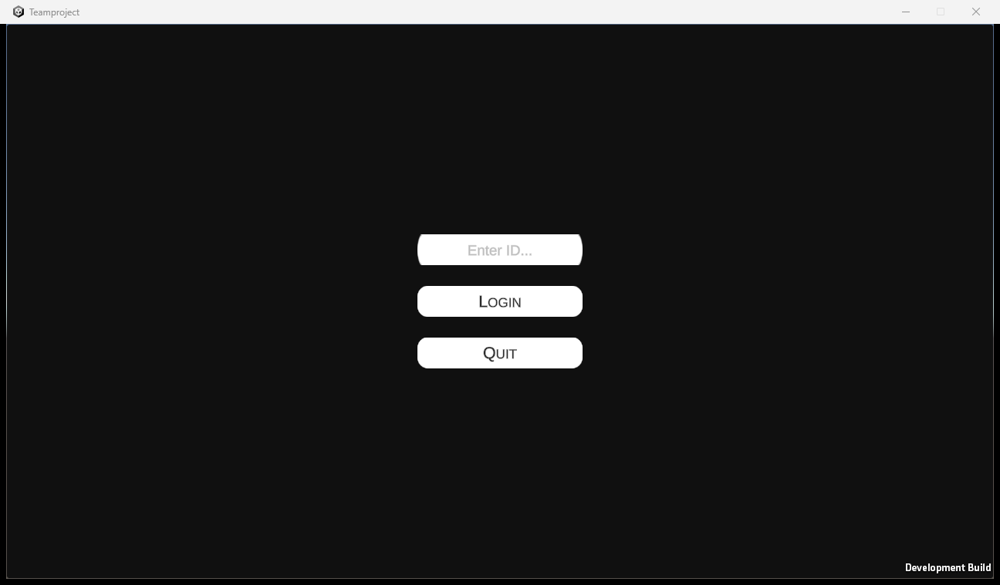

# SpicyCops

경찰을 피해 끝까지 살아남는 온라인 멀티플레이 파티 게임. 4인 팀 프로젝트 (Unity · Photon PUN · URP, 2023).

## 영상

## 게임

- 로비에서 방을 만들거나(비공개 방 포함) 들어가 채팅하고, 모이면 시작
- 경찰은 **어그로**가 높은 플레이어를 쫓는다. 안전 구역에 머물면 어그로가 서서히 오른다
- 아이템으로 서로 견제
  - 향수 폭탄: 맞은 상대의 어그로 +10
  - 연막탄: 맞은 상대의 어그로 -10
  - 빙결 폭탄 · 잉크 · 해머 · 신발 등
- 다른 플레이어를 밀고 당길 수 있다
- 잡힌 순서로 순위가 정해지고, 제한 시간이 끝나면 결과
- 코인으로 상점에서 캐릭터 스킨 구매

## 플레이

[Releases](../../releases)에 개발 중 테스트 빌드(Windows)가 있다. 아이디를 입력해 접속하는 방식이고, 온라인 서버(Photon) 연결은 보장하지 않는다.

## 담당

로비(로그인 · 방 목록 · 비공개 방 · 채팅 · 상점), 인게임 관리(어그로 · 생존 · 순위 · 시간), 인게임 UI
